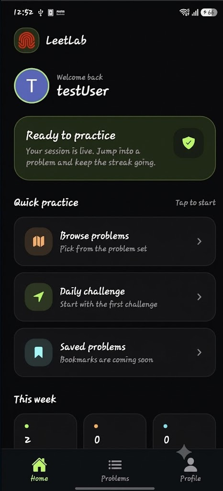
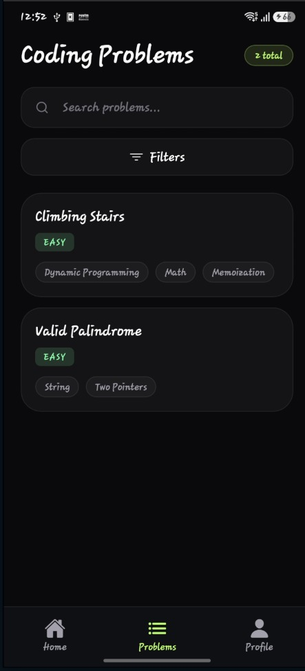
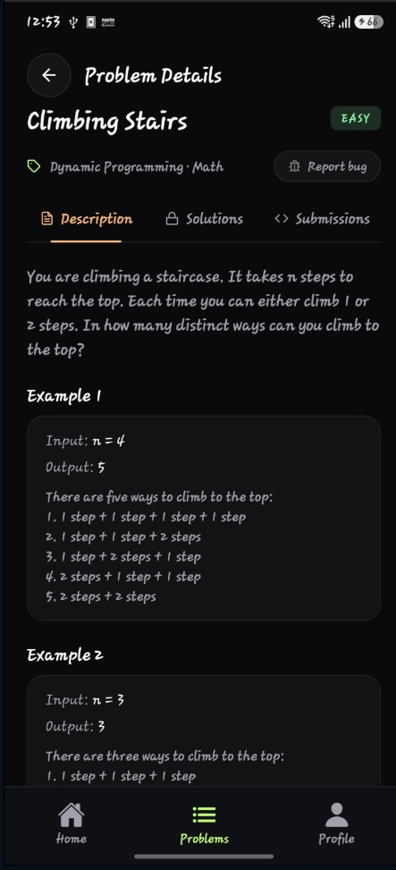
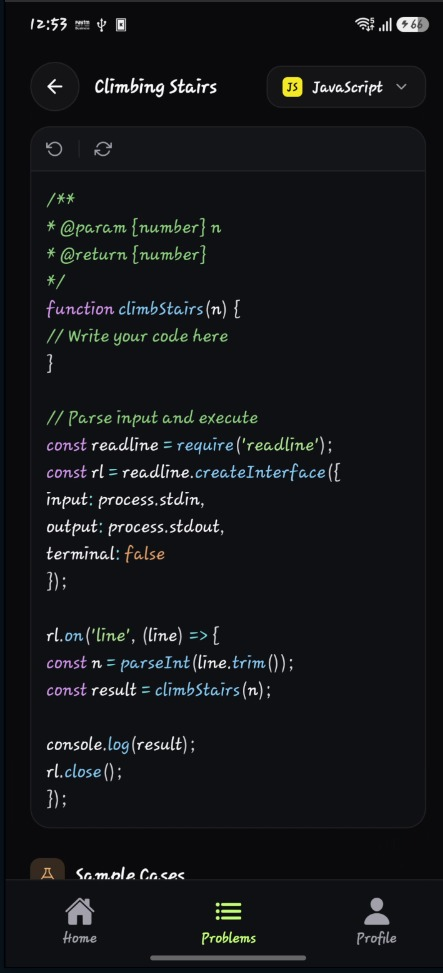
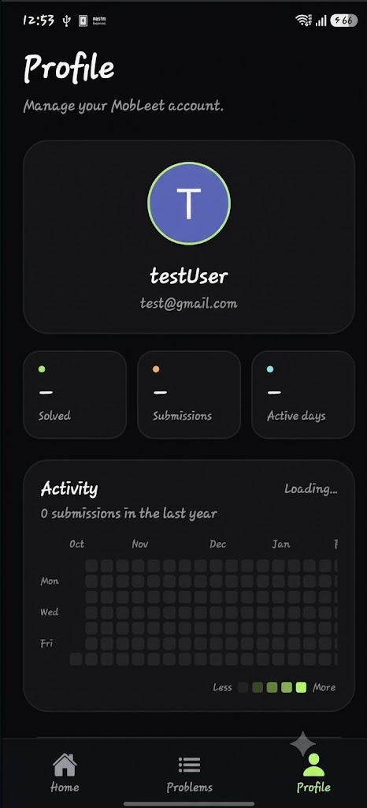

# LeetLab — LeetCode in Your Pocket

> Mobile LeetCode client built with **Expo + React Native + Supabase**. Browse problems, read statements, code in-app, and submit to a server-side judge that runs hidden test cases.

**Stack:** Expo SDK 55 · React 19 · TypeScript · Expo Router · HeroUI Native + Tailwind v4 · Zustand · Supabase (Auth + Postgres + RLS) · CodeBox judge · EAS Build
**Platforms:** Android · iOS · Web

<p align="center">
  
  
  
  
  
</p>

<p align="center">
  <em>Home · Problems · Detail · Editor · Profile</em>
</p>

---

## Features

- **Problem library** — Supabase-backed list with search, tag filters, loading / error / empty states.
- **Problem detail** — Statement, examples, hints, constraints, acceptance rate + derived difficulty.
- **Code editor** — Language switcher (JS, Python, Java), starter templates, empty-code guards.
- **Judge verdicts** — Dedicated result screen: `Accepted / Wrong Answer / Error`, passed count, per-case expected-vs-got + time.
- **Auth** — Google Sign-In only → Supabase `signInWithIdToken`. Protected tabs, persisted session.
- **Profile** — Avatar + account card + activity heatmap + sign-out.

Difficulty is derived, not stored: `≥60% acceptance → Easy, ≥40% → Medium, else Hard`.

---

## How it works

```
App (Expo Router) → Supabase (Auth + public problem data)
App → POST /api/submit (Bearer JWT) → verify user → fetch hidden test_cases (service_role)
  → CodeBox (Judge0-compatible, wait=true) → compare stdout → verdict + best-effort submissions insert
```

- `test_cases` are **never readable client-side** (column-level GRANTs). Only the API route uses `service_role`.
- No Edge Functions. Server logic is `src/app/api/submit+api.ts` via `expo-server`.
- No `ios/` / `android/` dirs — Continuous Native Generation via `app.config.js`.

---

## Getting started

### Prerequisites

- Node 20+ + Bun (`bun.lock` present — use `bunx`, not `npx`)
- Supabase project, CodeBox instance, Google OAuth web client ID + `google-services.json`
- Dev build required — Expo Go won't work (native Google Sign-In)

### 1. Install

```bash
bunx expo install
# or: bun install
```

### 2. Configure

Create `.env` in root:

| Key | Public? | Purpose |
|---|---|---|
| `EXPO_PUBLIC_SUPABASE_URL` | Yes | Supabase URL |
| `EXPO_PUBLIC_SUPABASE_KEY` | Yes | Publishable / anon key |
| `EXPO_PUBLIC_GOOGLE_WEB_CLIENT_ID` | Yes | Google OAuth client |
| `EXPO_PUBLIC_API_URL` | Yes | Override `/api/submit` base (prod / physical device) |
| `SUPABASE_SERVICE_ROLE_KEY` | No | Reads hidden `test_cases` — never `EXPO_PUBLIC_` |
| `CODEBOX_URL` / `CODEBOX_API_TOKEN` | No | Judge endpoint + token |

Never commit `.env` or `google-services.json`. On EAS, `google-services.json` is injected via `GOOGLE_SERVICES_JSON`.

### 3. Run

```bash
bunx expo start
bunx expo run:android   # or run:ios — dev build
```

Physical device hitting local API:

```bash
EXPO_PUBLIC_API_URL=http://192.168.x.x:8081 bunx expo start --dev-client
```

### 4. Verify (required before done)

```bash
bunx expo lint
bunx tsc --noEmit
```

---

## Project structure

```
src/app/              # Routes only — (auth)/login, (tabs)/home, problems, [problemId]/detail, codeEditor, result, profile + api/submit
src/components/       # auth/, home/, problems/, editor/, result/, profile/, ui/
src/stores/           # useSessionStore, useProblemsStore, useProfileStore
src/hooks/            # useGoogleAuth, useProblem (never selects test_cases)
src/lib/              # supabase, supabase-admin, judge, submit, difficulty, highlight
supabase/migrations/  # profiles trigger + RLS, problems + seeds, test_case hiding, submissions
app.config.js / eas.json / global.css / src/theme.ts
```

Keep non-route code outside `src/app/`. Keep `src/theme.ts` ↔ `global.css` in sync (dark-only `#0F1115` + emerald `#00D09E`).

---

## Database (Supabase + RLS)

- **profiles** — `id → auth.users.id` (auto-created by trigger), `name`, `avatar_url`. Users read/update own row only.
- **problems** — `problem_id, title, description, examples[], tags[], hints[], constraints[], languages[], acceptance_rate, code_snippets{}, test_cases[]`. `test_cases` hidden from clients.
- **submissions** — One aggregate row per submit (`status, passed, total, results jsonb`). Written best-effort by the API; no history UI yet.

Seeded: **Two Sum** (5 cases) + **Valid Parentheses** (6 cases). JS + Python starters included; Java runs on the judge but starts empty.

Setup:

```bash
supabase link --project-ref <ref>
supabase db push
```

---

## Builds

```bash
bunx eas-cli build --profile development   # dev client
bunx eas-cli build --profile preview       # internal
bunx eas-cli build --profile production
```

`android.package: com.saumyajha.LeetLab`, `scheme: leetlab`, portrait only.

---

## Limitations → Roadmap

Current gaps: hardcoded `WeekStats`, `Saved` is a no-op, no submission-history UI, plain `TextInput` editor (no highlighting), Java has no starter snippet.

Next: history + real stats → bookmarks → difficulty column → streaks/XP → syntax highlighting → offline drafts (`expo-sqlite` ready) → more languages → admin problem UI → tests.

---

## Contributing

1. Fork + branch (`feat/…`, `fix/…`).
2. New deps only via `bunx expo install <package>`.
3. Run `bunx expo lint` + `bunx tsc --noEmit` before pushing.
4. Never commit `.env`, `google-services.json`, or `ios/`/`android/`.

Docs: [Expo v55](https://docs.expo.dev/versions/v55.0.0/) · [Expo LLMs](https://docs.expo.dev/llms.txt) · [Router](https://docs.expo.dev/router/introduction/) · [EAS](https://docs.expo.dev/eas/)


